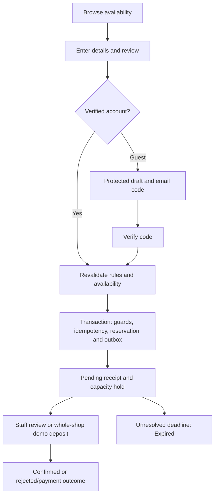

# Current implementation

Reviewed against the working tree on 2026-11-04, including uncommitted feature work. This is a source inventory, not evidence of deployment, applied migrations, passing tests or production readiness. Requirements remain in [PROJECT.md](PROJECT.md); persistence is described in [DATABASE.md](DATABASE.md). The schema-hardening release requires migration 006 and adds no admin workflows. The shared checkout also registers the separate guest-recovery migration 007.

## Feature status

| Area | Present in source | Remaining boundary |
| --- | --- | --- |
| Public pages | Home, about, gallery, contacts, services and availability | Published content does not establish approved pricing/coaching policy |
| Accounts | Email/password registration, six-digit verification, sign-in/out, password reset, lockout and optional Google authentication | Google requires credentials; matching email never silently links identities |
| Customer account | My Reservations, profile/contact editing and transactions navigation | Transactions show owned whole-shop demo payment state/history, not a financial ledger or receipts |
| Guest booking | Protected draft, email code, availability recheck, atomic Pending submission and secure status link | Drafts hold no capacity; references alone grant no access |
| Account booking | Verified accounts submit directly; profile contact defaults with legacy reservation fallback | Booking contact edits do not update the saved profile |
| Allocation | Multi-bay and whole-shop booking, schedule blocks, persisted guards and idempotency | No separate allocation collection or named-coach scheduling model |
| Staff review | Staff/Admin queue, approval/rejection, coach confirmation and cancellation decisions | No general staff-assisted creation, rescheduling, extension or attendance workflow |
| Notifications | Durable SMTP outbox, verification, booking events, Pending alerts and expiry | No pre-start reminder, SMS/Viber provider or notification administration UI |
| Whole-shop checkout | Explicitly enabled Development/Demo simulation and 50% demonstration deposit | No real collection, authenticated live POS exchange or production payment confirmation |
| Reports/inquiries | Public contact information | No operational reporting dashboard or predefined-answer chatbot |

## Booking rules currently enforced

- Five regular bays and two VIP bays. Migration 004 retires `bay-1`; stored `bay-2`–`bay-6` display as Bay 1–5 and `vip-7`/`vip-8` as VIP 1/2. Preserve IDs/history.
- Asia/Manila venue time: Monday 11:00–midnight, other days 10:00–midnight. Store UTC instants; conflicts use half-open `[start, end)` intervals.
- Ordinary sessions: 30-minute start/duration increments, minimum 30 minutes, maximum 840 minutes within opening hours. Whole-shop: 15:00–21:00 or opening–midnight.
- Regular review/lead time: 30 minutes; other services: 60. Submission must fit opening hours, configured approved review coverage and booking start. No maximum advance-booking horizon is enforced.
- Verified submission creates Pending and holds capacity. Regular alerts occur at 15/25 minutes; longer windows use 30/50. Expiry uses the saved deadline; older records retain their policy.
- Total capacity: eight per regular bay, ten per VIP bay; group coaching capped at eight. The current form records total guests including non-players. Legacy participant splits remain readable; staff must check the six-player limit when splits are absent.
- Service identifiers: `Regular`, `VIP`, `PhilippineCoach`, `KpgaPro`, `KpgaGroup`, `WholeShop`. KPGA Pro is Tuesday/Thursday/Saturday; group coaching is Tuesday 15:00–16:00. These application assumptions do not establish client-approved coaching terms.
- Staff approve Regular/VIP; coaching also requires the coach-confirmed flag. Whole-shop demonstration deposit success confirms through the demo flow.
- Customers may request cancellation of Pending/Confirmed bookings at least one hour before start; staff accept or decline. A request alone releases no capacity.
- Capacity queries protect `Pending`, `Confirmed` and legacy `Checked-In`. Current actions also produce `Rejected`, `Cancelled` and `Expired`. Proposed `CheckedIn`/`NoShow` identifiers are not the implemented lifecycle contract.

## Current booking flow

## Document boundaries

[ONBOARDING.md](ONBOARDING.md) covers configuration, [TESTING.md](TESTING.md) verification, and [MIGRATIONS.md](MIGRATIONS.md) explicit database deployment. October specifications, foundation plans, Chapter I and exported diagrams retain historical/target-design context. They are not a current feature checklist. This inventory describes implementation without approving new venue policy.

## Existing-feature schema hardening

Migration 006 adds typed collection validators, interval-order validation, optional CustomerAccountId links for account-owned bookings and the owner/creation-time history index. New email challenges have explicit purposes and new history writes separate EventType from ReservationStatus while preserving the old display description. Legacy BSON field names/collections remain mapped for compatibility; old history and unknown legacy challenge purposes are not invented. Readiness requires 001–007. Deployment requires the coordinated backup/stop/migrate/start procedure in MIGRATIONS.md; live/shared database migration is not implied by this source change.
