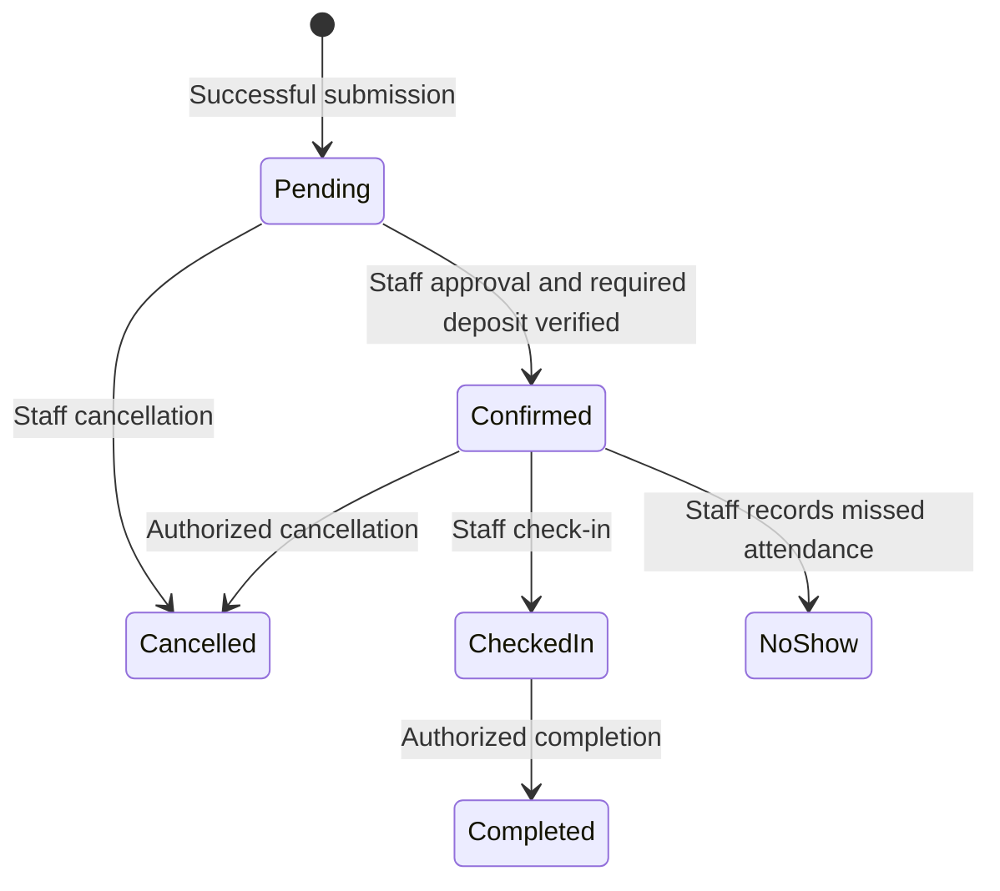
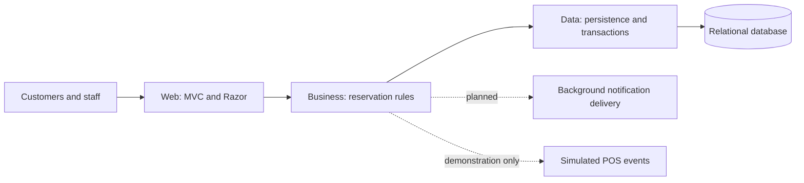

# Project Documentation

## Overview and source alignment

The Hole In Hub Golf & Lounge Reservation Management Subsystem manages customer bookings, resource schedules, allocation, and reservation records. Its central goal is reliable single- and multi-bay scheduling with staff approval.

This document describes planned functionality, not a completed application. Sources are the supplied `GROUP2_CHAPTER_1.docx.pdf`, pasted project proposal, owner clarifications in the discussion, and inspection of the existing repository. Explicit owner clarifications take precedence over conflicting drafts. POS and voucher implementation are excluded from research scope and shown only through a labelled demonstration. See [Chapter I](CHAPTER_1.md) for the aligned manuscript; this does not constitute academic approval or independently verified field research.

The reported existing workflow uses a local browser interface with manual steps: individual bay bookings are merged for groups, customer records are cross-referenced, and simultaneous changes risk conflicting allocations. Startup delays are reported in the sources, not measured in this repository.

## Scope

Research implementation includes calendar/timeline scheduling, services and packages, availability for Bays 1–6 and applicable private spaces, multi-bay allocation, customer records/history, reservation creation and management, role-based access, reports, notifications, and a predefined inquiry chatbot. Whole-shop deposit verification gates staff confirmation; actual payment collection remains external.

Demonstration-only: estimated charges, voucher example, deposit verification, and final settlement through a simulated POS handoff using a reservation reference. No production POS connector, payment gateway, billing engine, voucher validation/redemption, or voucher ledger is required. Simulation must never be presented as real payment evidence.

Excluded: inventory, merchandise ordering, accounting, payroll, receipts, payment processing, voucher sales/redemption, and simulator hardware control. Availability reflects records and configured schedules, not detected physical occupancy.

## Business rules

| Topic | Current rule |
| --- | --- |
| Membership | No membership requirement |
| Customer accounts | Guest booking with optional accounts is recommended; final access policy needs approval |
| Selection | Choosing date/time alone does not hold resources |
| Submission | Successful submission creates Pending and immediately blocks resources |
| Approval | Staff manually confirm; no automatic confirmation |
| Pending duration | No automated expiration; held until staff confirm or cancel |
| Multi-bay | Adjacent bays not required; specific or automatically/staff-allocated bays must be available |
| Operating hours | Monday 11 AM–midnight; Tuesday–Sunday 10 AM–midnight, Philippine venue time |
| Session duration | Normally 60 minutes; certain services/promos allow 30 minutes |
| Buffers | No designated turnaround buffer supplied |
| Daily limits | No supplied limit on bays or reservations per customer per day |
| Whole shop | Blocks all facility resources; upfront verified deposit before staff confirmation |
| Attendance contact | Staff contact the customer 15 minutes before the slot by phone/messaging |
| Grace period | 60 minutes; accommodate in reserved or another available bay |
| End time | Original end remains unless staff validate a shift/extension; extra time is billed externally |
| No-show | Staff record No-Show after missed attendance under the grace rule; intentional cancellation is Cancelled |
| Rescheduling | Staff change date/time; system validates conflicts |
| Pricing | External POS owns authoritative rates/packages/promos/vouchers; portal shows estimates |
| Utilization | Reserved time, not actual play time |

Treat midnight as the beginning of the next day. Session duration does not establish the exact selectable start-time grid. Automated 24-hour reminders and manual 15-minute attendance contact are separate processes.

## Reservation lifecycle

`CheckedIn` displays as **Checked-In**. This normal transition model is an engineering recommendation; exceptional corrections and rescheduling reconfirmation need policy approval. Record who performed each change.

Deposit and final settlement states are separate from reservation status. A deposit never means Completed. The owner describes final POS payment updating the booking to Completed; demonstrate that external event rather than requiring live POS. Recommended safeguard: do not complete a future or active session solely because it was prepaid. Exact completion timing remains unresolved.

Pending requests need an age indicator and staff review queue. Do not add automatic cancellation contrary to the current rule.

## Roles and pages

| Role | Proposed access |
| --- | --- |
| Guest | Services, availability, booking, verified access to own reservation |
| Customer account | Own profile and reservation history; self-service changes only if policy permits |
| Front desk | Customer lookup, walk-ins, Pending review, confirmation, rescheduling, check-in, cancellation, no-show and completion |
| Supervisor | Oversight, reports, permitted policy exceptions without resource overlaps |
| Administrator | Users/roles, resources, services, hours, and configuration |

The workflow mentions staff PIN access. Use individual staff identities with protected credentials and attempt throttling; a shared PIN cannot support reliable attribution. Server-side permissions and ownership checks are required, including requests outside the normal UI.

| Area | Logical screens |
| --- | --- |
| Public | Home/services; availability/booking; review/result |
| Shared | Sign-in, recovery, optional customer registration |
| Customer | Profile; active/history reservations; reservation details |
| Staff | Schedule with calendar/timeline tabs; reservation list/Pending queue; create/edit/details; customers/history |
| Supervisor | Reservation reports and utilization |
| Admin | Resources/hours/closure blocks; services/packages; users/settings |
| Demo | Clearly labelled simulated POS handoff |

Reuse one booking form for create/edit. Embed the chatbot as a widget. Screens do not require separate applications or a controller for every row. The Pending queue shows hold age and deposit verification. Reservation details supports reassignment/extension and change history.

## Architecture and implementation status

Use one deployable ASP.NET Core MVC application with the existing three layers.

| Project | Existing state | Planned responsibility |
| --- | --- | --- |
| HoleInHub.Web | .NET 10 MVC starter; Home, Privacy, Error; Tailwind; configuration | Controllers, forms, view models, role-aware views, authentication wiring |
| HoleInHub.Business | Class library referencing Data; no domain services | Availability, allocation, lifecycle, reports, notification coordination |
| HoleInHub.Data | Class-library scaffolding | Entities, persistence, transactions, migrations |
| Root launcher | Runs web project | Development convenience |

`Program.cs` registers MVC, but does not configure authentication or a database. `UseAuthorization()` alone is not role-based security. No reservation services, production POS integration, notifications, or chatbot are implemented. The database engine and persistence library have not been selected. Keep business rules shared between staff and customer flows.

## Proposed data model

| Record | Purpose |
| --- | --- |
| Customer | Central contact record, independent of login |
| User account/role | Authentication and permissions; optional customer link |
| Resource | Bay/private space, active state, capacity when established |
| Service | Offering, duration/resource eligibility, whole-shop/deposit requirement |
| Reservation | Reference, customer/organizer, attendees, service, start/end, status |
| ReservationResource | Multiple resource allocations for one booking |
| Operating schedule/resource block | Hours, maintenance, closures |
| Reservation history | Actor, timestamp, changes and reasons |
| Notification delivery | Scheduled message, outcome, retry information |
| Demonstration transaction reference | Explicitly simulated deposit/final settlement evidence |

Recommended first-version assumption: resources in one reservation share a time interval. Separate visits can use separate records. Do not automatically merge customers by name or link histories without verified ownership. Preserve historical bookings when services/resources are deactivated. No voucher or billing ledger is needed for research scope.

## Correctness and security

- Include Pending allocations and closure blocks in availability checks.
- Use half-open intervals `[start, end)` so adjacent sessions can meet without a buffer.
- Protect allocation within the save transaction using concurrency protection appropriate to the selected database. A pre-save availability query alone cannot prevent simultaneous conflicts.
- Commit all resources together or reject the entire booking. Whole-shop allocation conflicts with any resource booking.
- Reschedule atomically; failure preserves the original allocation.
- Detect duplicate submissions and stale staff edits rather than silently duplicating/overwriting records.
- Release remaining capacity on Cancelled/No-Show while preserving history. Retain completed records for reports.
- Reassignment and extension require conflict checks; the grace period must not displace another customer.
- Protect customer information, management links, and server actions. A booking reference alone is not authorization.
- Apply server validation, access checks, browser anti-forgery protection, accessible forms, and clear conflict feedback.
- Deliver notifications after commit; delivery failure does not undo a reservation. Avoid duplicate/stale reminders after changes.

## Reporting and evaluation

Reports cover volume by date/status, service usage, peak times, customer booking trends, cancellations/no-shows, and resource reserved hours. Show Pending holds separately from fulfilled bookings.

Proposed utilization is reserved resource-hours divided by bookable resource-hours for the period. Exclude closure/maintenance time from the denominator. Status inclusion rules require approval; actual play-time usage is not measured.

Evaluate concurrent conflicting submissions, multi-bay rollback, whole-shop exclusion, safe rescheduling, status permissions, customer ownership, deposit confirmation gating, notifications, and report accuracy. Measure startup and schedule responsiveness under documented workloads. Performance targets, participants, and results have not been established; do not invent evaluation outcomes.

## Implementation order

1. Finalize policies and select authentication/persistence.
2. Implement customers, services/resources, hours, transactional allocation, and concurrency protection.
3. Add staff access, review queue, management, timeline, and history.
4. Add customer booking/verified access and optional accounts if approved.
5. Add reports, notifications, chatbot, and isolated POS demonstration.
6. Evaluate research features separately from simulated external behavior.

## Open decisions and operational risks

- Final guest/account policy, PIN authentication design, permissions, and customer cancellation rights.
- Deposit amount/evidence, unpaid-hold follow-up, cancellation/refund policy.
- Maximum duration, start-time grid, attendee capacity, eligible resource combinations.
- Grace-period behavior when 30/60-minute sessions have already ended; post-end resource holds.
- Reconfirmation after rescheduling, exceptional transitions, and completion timing for prepayment.
- Notification provider/channel and reminders for bookings made less than 24 hours ahead.
- Database engine, preview pricing source, report status inclusion, evaluation targets, and legacy migration.

Indefinite Pending holds can block availability without payment or attendance. Staff review is essential under the stated policy. No automatic expiry is currently authorized.

## Development

See the root [README](../README.md) for build/run and CSS instructions. Keep controllers thin, use shared services, and follow existing layers. Avoid production billing/voucher functionality or separate microservices for demonstration needs.
