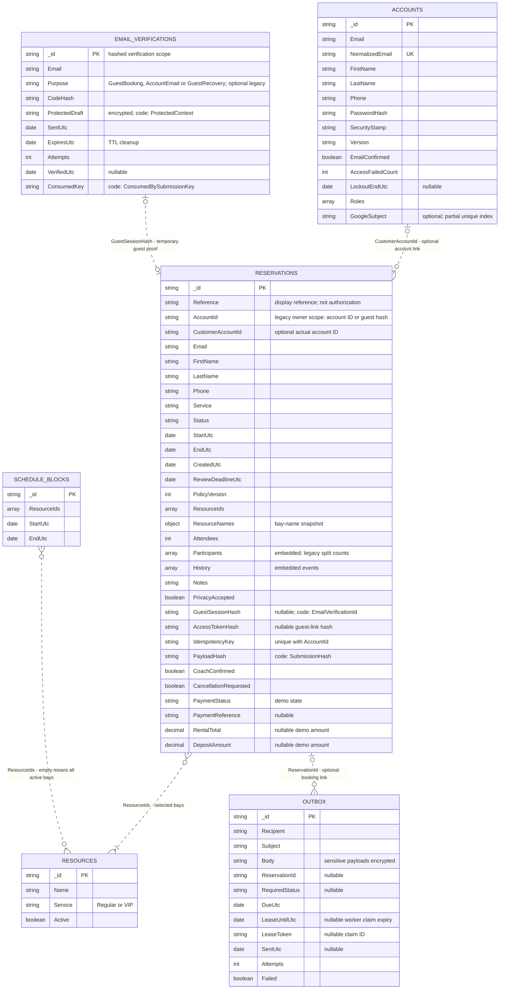
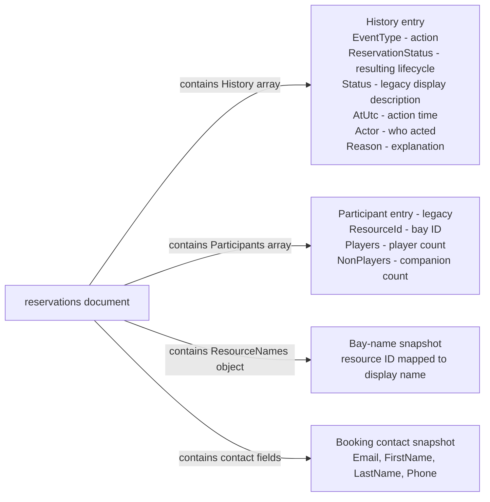

# Current MongoDB data model

Based on application records and migrations 001–007, reviewed 2026-11-04. This is the implemented model, not the older proposed schema. See [database dictionary](../DATABASE.md) for full field definitions, validators and indexes.

Types describe application values: date means a BSON UTC date; nullable fields may contain null, while optional fields can be absent in legacy records. Exact requiredness and accepted BSON representations remain in the [schema dictionary](../DATABASE.md) and its JSON references. Property names below use **stored MongoDB names**, including legacy mappings.

## Collection relationships

**How to read this diagram:** Accounts can have many bookings; a guest booking has no required account link. Each booking selects one or more bays. A bay can appear in many bookings over time, but protected intervals must not overlap. Outbox messages may relate to one booking or be independent account/verification emails.

The diagram shows logical references checked by application operations, **not MongoDB foreign-key constraints**. PK means document identifier; UK means unique indexed value. The Google subject index applies only to present string values. Reference is not declared unique by the current migrations.

EMAIL_VERIFICATIONS is the friendly diagram name for the physical `guest_verifications` collection. GuestSessionHash links only guest-booking proof, not every account/recovery challenge. A proof is consumed by at most one booking; TTL can later remove it while the booking retains its hash. This is not a permanent required relationship. Email-based recovery lookup is an application rule, not a foreign key or automatic account association.

## Embedded booking records

These are fields inside a booking, not separate collections. New total-guest bookings use Attendees and leave Participants empty. Legacy history may omit EventType and ReservationStatus; old descriptions remain intact. Profile changes do not rewrite the booking's contact snapshot.

## Internal supporting collections

```mermaid
erDiagram
    ALLOCATION_GUARDS {
        string _id PK "catalog or resource ID plus Manila date"
        number version "transaction contention counter"
    }
    GUEST_RECOVERY_QUOTAS {
        string _id PK "hashed email"
        date_array IssuedUtc "recovery email issuance times"
        date ExpiresUtc "TTL cleanup date"
        long Version "concurrent update counter"
    }
    MIGRATIONS {
        ObjectId _id PK
        string migrationId UK "applied upgrade identifier"
        string description "upgrade purpose"
        string checksum "authored migration fingerprint"
        date appliedAtUtc "successful application time"
        long executionDurationMs "duration in milliseconds"
    }
    MIGRATION_LEASES {
        string _id PK "exclusive migration lease identifier"
        string owner "current runner identifier"
        date acquiredAtUtc "claim acquisition time"
        date expiresAtUtc "claim expiry time"
        date lastHeartbeatAtUtc "last renewal time"
    }
    SYSTEM_HEARTBEATS {
        string _id PK
        date lastPingAtUtc "foundation heartbeat timestamp"
        string environment "foundation initialization label"
    }
```

These five collections have no stored foreign-key relationship to the business collections. Booking transactions update allocation_guards; recovery email issuance updates guest_recovery_quotas; the explicit Migrator uses the other three. Counters use numeric BSON types; recovery Version is a C# long. The migration document `_id` is a BSON ObjectId even though the C# property is a string.

## Physical collection names

| Diagram name | MongoDB collection |
| --- | --- |
| ACCOUNTS | accounts |
| RESERVATIONS | reservations |
| RESOURCES | resources |
| SCHEDULE_BLOCKS | schedule_blocks |
| EMAIL_VERIFICATIONS | guest_verifications |
| OUTBOX | outbox |
| ALLOCATION_GUARDS | allocation_guards |
| GUEST_RECOVERY_QUOTAS | guest_recovery_quotas |
| MIGRATIONS | __migrations |
| MIGRATION_LEASES | __migration_leases |
| SYSTEM_HEARTBEATS | system_heartbeats |

## Important constraints

- All instants are UTC; venue calendar dates use Asia/Manila. Reservation/block StartUtc must precede EndUtc. Intervals use `[start, end)`.
- Unique `(AccountId, IdempotencyKey)` prevents duplicate submission effects; PayloadHash checks that repeated submissions have the same details.
- CustomerAccountId is optional. AccountId remains the legacy guest/account ownership scope, not an unconditional reference to accounts.
- Booking conflicts and all-or-nothing multi-bay allocation are enforced through persisted guards and transactions, not relationship arrows alone.
- The current model has no separate customers, allocations, coaching_sessions, payments or receipts collections. Payment fields represent demonstration state only.
- Retained schema-compatible attendance states do not establish a completed admin attendance workflow.

The diagram is based on source, not a live database inspection. It does not certify production deployment or add planned admin/POS structures.
