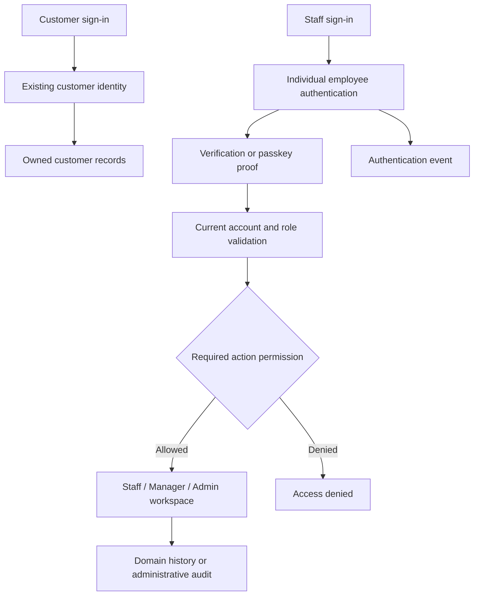

# RBAC and staff authentication proposal

Prepared 7 November 2026 from PROJECT.md, Chapter I, the production foundation, the existing architecture/DFD exports and the current account implementation.

The proposal records the original design discussion. The registered desktop PIN section describes the implemented sign-in and role behavior.

## Confirmed direction

The owner requests Customer, Staff, Manager and Admin roles, a separate staff sign-in and support for activity logs. Staff access must work from arbitrary devices, including personal phones.

Manager is the application name for the Supervisor responsibility in PROJECT.md and Chapter I. Older diagram exports remain historical references. They show customer/staff authentication and role/ownership authorization, but do not specify a PIN protocol or a complete role matrix.

Authentication-method selection and the proposed permission matrix below require owner confirmation before privileged routes or credential handling change.

## Current source

- ASP.NET Core Identity uses a custom MongoDB AccountStore, UserManager, SignInManager and persisted role arrays.
- Current roles are Customer, Staff and Admin. Registration forces Customer.
- BookingReviewController and CustomersController explicitly allow Staff and Admin. Admin-only block operations use additional action authorization.
- The shared sign-in uses email/password. Password failures count toward the existing five-attempt, fifteen-minute lockout. An additional IP limiter applies.
- The application cookie currently expires after eight hours. Role claims are generated from persisted roles.
- AccountStore exposes role reads but role-add and role-remove operations currently throw NotSupportedException.
- Security stamps and optimistic account versions already exist. Their presence alone does not establish immediate session revocation after a role change.
- Reservation and block histories record actors for domain operations. A general security/activity-event store and activity-log UI do not yet exist.

## Proposed role matrix

Permissions are server-enforced capabilities. Showing a navigation link is a separate presentation decision.

| Capability | Customer | Staff | Manager | Admin |
| --- | --- | --- | --- | --- |
| Browse and manage owned customer reservations | Own records | Only with customer ownership | Only with customer ownership | Only with customer ownership |
| Staff schedule, assisted bookings and customer lookup | Denied | Allowed | Allowed | Allowed |
| Reservation/change review and supported attendance | Denied | Allowed | Allowed | Allowed |
| Operational reports when implemented | Denied | Denied | Read | Read |
| Activity logs when implemented | Own customer history only | Existing booking histories | Operational events | Security and operational events |
| Create/release schedule blocks | Denied | Denied | Denied initially | Allowed |
| Resource/configuration mutations | Denied | Denied | Denied initially | Allowed |
| Provision employees, assign roles and disable access | Denied | Denied | Denied initially | Allowed |
| Bypass conflicts, verify a real payment manually or use an undefined exception | Denied | Denied | Denied | Denied |

Manager starts with operational access and oversight. Supervisor exceptions and Manager resource mutations remain explicit future decisions. Admin privileges do not grant access through customer ownership-only routes to another customer's booking. Staff review has its own protected route.

## Separate staff sign-in

Use /staff/sign-in for Staff, Manager and Admin. Customer sign-in remains under /account/sign-in. The staff page has clear staff identity, credentials, recovery and an administrative contact path. It has no public staff registration or role selector.

An arbitrary browser is an untrusted sign-in origin. A permanent six-digit secret has one million possible values and would be a centrally checked password. Device PIN guidance does not make that an adequate standalone public staff credential.

Choose one implementation path before writing authentication behavior.

1. Reuse individual email/password accounts and require a six-digit second verification step. Define whether the code is authenticator-generated or delivered, plus enrollment and recovery. The code expires or changes and is not a permanent reusable PIN.
2. Add passkey sign-in using supported browser/platform authenticators. Staff unlock the authenticator with their own device PIN or biometric. The application receives a signed challenge response rather than the device PIN. This requires credential enrollment/revocation, recovery and compatible deployment origins.

Never share one staff credential or make a PIN select a role. Every successful staff session must identify one employee account.

## Session and authorization enforcement

- Centralize role names and action permissions in Business. Web policies and navigation consume that definition.
- Require an eligible enabled employee account and completed authentication before staff access.
- Preserve Customer-only registration and existing ownership checks.
- Decide whether staff and customer sessions use separate cookie schemes before implementing the staff sign-in. Separate pages alone do not create separate sessions.
- Privilege changes and account disabling must invalidate existing staff access. Revalidate persisted authorization/security stamps at an explicitly chosen interval and rotate stamps on relevant changes.
- Keep anti-forgery protection, HTTPS secure cookies, generic sign-in failures and server-side retry limits.
- Apply durable account throttling to new credential/code verification flows. The current in-process IP limiter alone does not cover multiple application instances.
- Define a short staff inactivity lock and sensitive-action reauthentication. Exact timeout values remain a deployment/product decision.
- Protect the last active Admin with a guarded transaction covering concurrent role/disable changes.

## Activity logs

Keep reservation histories as the source for booking lifecycle events. Add a separate append-only security/activity stream for authentication and administration.

Each event needs an event ID, UTC timestamp, actor account ID where known, role snapshot, event type, outcome, target type/ID, correlation ID and an appropriate reason. Successful employee actions use the authenticated server-side actor, never a posted employee name. Failed sign-in events must not disclose whether an account exists to the browser.

Record successful/failed sign-in, lockout, sign-out, account disabling, credential reset and role changes as the feature is implemented. Keep credentials, PINs, OTPs, reset tokens, cookie values and sensitive request bodies out of logs. Store only the minimum network metadata justified by the security use case. Retention and Manager visibility into security-sensitive events remain decisions.

Admin role changes should commit the account version, role change, security-stamp update and audit event together. Authentication log delivery failures must have an explicit policy before deployment.

## Proposed flow

## Implementation order

1. Confirm the role matrix and authentication method.
2. Implement centralized roles/policies, Manager coverage and route/ownership tests.
3. Add guarded Admin employee provisioning, role changes, disabling, last-Admin protection and immediate/reasonably bounded session revocation.
4. Implement the separate staff authentication flow with enrollment, recovery, durable retry limits and attributable events.
5. Build read-only activity-log access with approved Manager/Admin scopes.
6. Update current documentation and new authentication/authorization diagrams. Keep historical exports labelled as historical.

Verify unauthorized/customer denial, each employee role, forged role claims and actors, revoked sessions, disabled accounts, code/credential replay, concurrent last-Admin changes, log redaction and preserved customer sign-in/guest access before release.

## Sources

- [Current project rules](../PROJECT.md)
- [Chapter I](../CHAPTER_1.md)
- [Foundation security requirements](2026-10-18-production-foundation.md)
- [Historical diagram guide](../diagrams/README.md)
- [ASP.NET Core roles](https://learn.microsoft.com/en-us/aspnet/core/security/authorization/roles?view=aspnetcore-10.0)
- [ASP.NET Core Identity configuration and security stamps](https://learn.microsoft.com/en-us/aspnet/core/security/authentication/identity-configuration?view=aspnetcore-10.0)
- [NIST authentication and device activation secrets](https://pages.nist.gov/800-63-4/sp800-63b.html)

## Registered desktop PIN

Staff, Manager, and Admin use a verified work account and its password on an enrolled desktop to set or reset a personal six-digit PIN at `/staff/pin/setup`. Daily sign-in at `/staff/sign-in` asks for the work email and PIN. The workspace shows Switch staff to end the staff session.

Staff sign-in starts disabled and requires configuration before staff can access the workspace. Apply migration 016 to the intended database before enabling it. It adds a TTL index for retry counters. The credentials collection stores salted password hashes of peppered PIN inputs, with one version per employee. Keep the random pepper in a secret store.

Enable staff sign-in using these configuration keys.

| Key | Value |
| --- | --- |
| StaffPin__Enabled | true |
| StaffPin__Host | Dedicated staff HTTPS hostname without scheme or port |
| StaffPin__Pepper | Random secret with at least 32 characters |
| StaffPin__DesktopFingerprints__0 | SHA-256 fingerprint of the first enrolled TLS client certificate |

Add one indexed fingerprint entry per desktop. Provision each private key as non-exportable on the work computer. Configure TLS to request and validate the client certificate on the staff hostname. Keep customer traffic on the public hostname. The app reads the certificate from the TLS connection. It does not trust a request header as desktop proof. A hosting setup that terminates TLS upstream needs a verified deployment design before enabling the pilot. See [ASP.NET Core certificate authentication](https://learn.microsoft.com/aspnet/core/security/authentication/certauth).

Every PIN-authenticated staff request rechecks the enrolled certificate, employee role, security stamp and PIN version. Remove a desktop fingerprint and reload application configuration to revoke that desktop. The staff cookie expires after 15 minutes of inactivity and has an eight-hour absolute cap. Durable counters allow five attempts per employee and 20 per desktop in each 15-minute window. PIN setup and reset also use the desktop counter and Identity password lockout.

The workspace requires the staff PIN session for all three employee roles. Staff, Manager, and Admin can use the schedule, assisted booking, customer lookup, reservation review, and attendance workflows. Manager and Admin can create and release temporary schedule blocks. Admin alone can add, retire, and restore bays in the inventory. An active booking can prevent a catalog change. The server reads current employee roles on every staff request and ends the session when those roles change. The application emits structured sign-in and switch events with the employee account ID where known. The persistent activity log remains future work.

### Presentation mode

For a private demonstration, start a Development HTTPS instance and set `StaffPin__PresentationAccount` to a verified account with the Staff role and an existing PIN. The sign-in page asks only for the PIN, and the HTTPS listener should use ordinary server TLS. Browsers need access to the configured staff hostname and must trust its HTTPS server certificate. The device retry quota is shared in this mode. Use a private preview network and remove the setting after the presentation.

### Local leadership walkthrough

`/manager` links to venue availability, the team directory, the daily report, booking histories, and review alert settings. `/admin` adds the account directory, bay inventory, public service catalog, and deployed booking settings. Services, settings, and the Manager team directory are read-only. The Admin directory includes customer accounts and supports audited staff role changes from an enrolled desktop after migration 017. PIN presentation mode keeps the directory read-only. The booking activity page links to existing reservation histories.

To enable Manager and Admin PINs without client certificates for a walkthrough, set `StaffPin__PresentationManagerAccount` and `StaffPin__PresentationAdminAccount` alongside the Staff presentation account. Use verified local demo accounts with the matching roles and distinct PINs. This mode requires a Development instance on `localhost`, a loopback MongoDB URI with `directConnection=true`, and a separate database whose name starts with `hih_role_demo_`. The sign-in page lists the configured demo roles. Use the existing certificate-based sign-in for deployed employee accounts.
